# Character–Adjective Analysis in English Novels

## Project Overview

This personal portfolio project explores how a traditional NLP pipeline links
character names to nearby adjectives in English novels. It demonstrates text
preprocessing, named entity recognition, part-of-speech tagging, co-occurrence
statistics, and analysis of model errors.

The project began as a **2023 PfL course assignment**. This repository contains
the **2026 maintenance and repair version**. It fixes two scoring errors and
documents reproducible runs. The original submission remains separate.

## NLP Pipeline

```mermaid
flowchart LR
    A[Locally supplied English novel] --> B[Clean Gutenberg metadata]
    B --> C[Punkt sentences and English filtering]
    C --> D[spaCy PERSON entities and nearby ADJ tokens]
    D --> E[Pair counts and PMI ranking]
    E --> F[Top three adjectives per name]
    F --> G[Average similarity to sentiment seeds]
    G --> H[Scores, labels, and aggregate results]
```



Full texts and rejected sentences stay in a local directory outside the repository.

## Methods

- **Preprocessing:** NLTK Punkt sentence splitting and py3langid English labels.
  Whitespace is normalized. Blank and punctuation-only fragments are excluded.
  Gutenberg wrappers and known production credits are removed.
- **Extraction:** spaCy `en_core_web_sm` identifies `PERSON` spans. Adjectives
  come from the span and the two tokens on each side. Names remain separate
  strings; aliases are not merged.
- **Ranking:** pointwise mutual information (PMI) uses character–adjective
  pair counts. With total pair events `N`, joint count `c(x,y)`, and marginal
  counts `c(x)` and `c(y)`, the score is
  `log2(c(x,y) * N / (c(x) * c(y)))`. Scores are rounded to five decimal places.
  Only names with at least three distinct adjectives receive a top-three list.
- **Sentiment heuristic:** `en_core_web_md` provides static word vectors.
  Similarities are averaged over all three adjectives and each five-word seed
  set. The higher mean gives `Positive` or `Negative`. A tie gives `Neutral`.
  Missing vectors give `Unscored`.

The course supplied the seeds:

| Positive | Negative |
|---|---|
| good, amazing, happy, trustworthy, friendly | bad, angry, evil, stubborn, disgusting |

## Reproducibility

The verified environment is **Python 3.12.6 on macOS arm64**:

| Component | Version |
|---|---|
| spaCy | 3.8.16 |
| NLTK | 3.10.3 |
| py3langid | 0.4.0 |
| `en_core_web_sm` / `en_core_web_md` | 3.8.0 / 3.8.0 |

Run commands from the repository root. Create the environment outside it:

```sh
python3 --version  # The recorded interpreter is 3.12.6.
python3 -m venv ../.local-validation/.venv
../.local-validation/.venv/bin/python -m pip install -r requirements-lock.txt
../.local-validation/.venv/bin/python -m pip check
```

These commands install the locked versions of the successfully used dependencies.
Before running tests, follow the official `punkt_tab` download, hash check, and
`NLTK_DATA` setup in [the reproduction guide](docs/REPRODUCE.md). The archive
and English resource hashes are recorded in [nltk-resource.json](docs/nltk-resource.json).

```sh
../.local-validation/.venv/bin/python -m unittest discover -s tests -v
../.local-validation/.venv/bin/python pipeline.py ../.local-validation/inputs/dorian_gray.txt ../.local-validation/runs/dorian_gray --book 'The Picture of Dorian Gray'
../.local-validation/.venv/bin/python validate_run.py ../.local-validation/runs/dorian_gray --report ../.local-validation/dorian_check.json
```

Supply a legally obtained UTF-8 book at the input path. Each output directory
must be new and outside the repository. Use the same command with your locally
held Dune file to run that book. No book download is included.

**29 tests passed.** Each novel also passed complete pipeline validation and
two identical runs in the same environment. See [test results](docs/unit-tests.txt),
[environment metadata](docs/environment.json), and [verification evidence](docs/verification.json).
A fresh install on a second machine has not been tested. Exact output matching
also requires the input hashes in the run summaries; current book editions may differ.

## Actual Results

These are saved **2026 repair results**, not reconstructed 2023 sentiment labels.

| Measure | Dune | The Picture of Dorian Gray |
|---|---:|---:|
| Retained sentences | 17,900 | 6,277 |
| Unique `PERSON` name strings | 396 | 236 |
| Character–adjective pair events | 333 | 162 |
| Names with a top-three list | 26 | 6 |
| Positive / Negative | 12 / 12 | 2 / 4 |
| Neutral / Unscored | 0 / 2 | 0 / 0 |

Name strings are model predictions, not a verified character census.
[Dune outputs](results/dune/run_summary.json) and
[Dorian Gray outputs](results/dorian_gray/run_summary.json) include aggregate
counts, PMI values, top adjectives, and vector similarity scores.
Raw and preprocessed novels are excluded.

| Book / name | Top adjectives | Label |
|---|---|---|
| Dune / Paul | awake, asleep, bent | Negative |
| Dune / Baron | expensive, personal, best | Positive |
| Dorian Gray / Basil | wrong, angry, pressing | Negative |
| Dorian Gray / Dorian Gray | real, nice, pale | Negative |

There is no labeled evaluation set. No accuracy or performance improvement is claimed.

## Error Analysis & Limitations

- **Sentence and language errors:** short English dialogue can be rejected by
  language identification. Punkt can split dialogue and abbreviations poorly.
- **Entity and POS errors:** organizations and titles can be tagged as people.
  Invented names may be tagged as adjectives. `Piter` and `Thufir` are unscored
  because their lists include words without vectors.
- **Local association is weak:** a nearby adjective may describe someone else.
  Windows can cross sentence boundaries. Rare pairs can receive high PMI.
- **Names are fragmented:** `Dorian Gray` and `Dorian Gray's` are separate entries.
  `Harry` and `Henry` receive different labels. No alias or pronoun resolution is used.
- **Labels have a narrow meaning:** vector similarity to seeds does not establish
  personality, morality, or narrative role. Baron's `Positive` label illustrates
  this problem. Static vectors do not resolve negation, irony, or context.

The 2026 repairs correct arithmetic, file handling, and metadata contamination.
They retain the course method. The controlled arithmetic comparisons in
[Dune](results/dune/comparison.json) and
[Dorian Gray](results/dorian_gray/comparison.json) are separate from historical
artifact comparisons. Changed labels are not evidence of improved accuracy.

## Provenance & Acknowledgments

The 2023 PfL course supplied the project task, method requirements, Dune copy,
model choices, window rule, and sentiment seeds. These are acknowledged course
inputs, not original research contributions. I independently wrote the 2023
code implementation. The 2026 maintenance work repairs that implementation
and adds tests, version records, and portfolio documentation with OpenAI Codex
assistance.

The second novel is Oscar Wilde's *The Picture of Dorian Gray*, using the
historical [Project Gutenberg eBook 174](https://www.gutenberg.org/ebooks/174)
input. Both books are referenced for provenance; their full texts are not bundled.
See [provenance](PROVENANCE.md) and [third-party materials](docs/THIRD_PARTY.md).

**Publication status:** this candidate has completed documentation and release
checks. It awaits my final approval before a GitHub push. Course documents,
novel texts, and private submission information remain excluded.
No repository-wide open-source license has been assigned.
